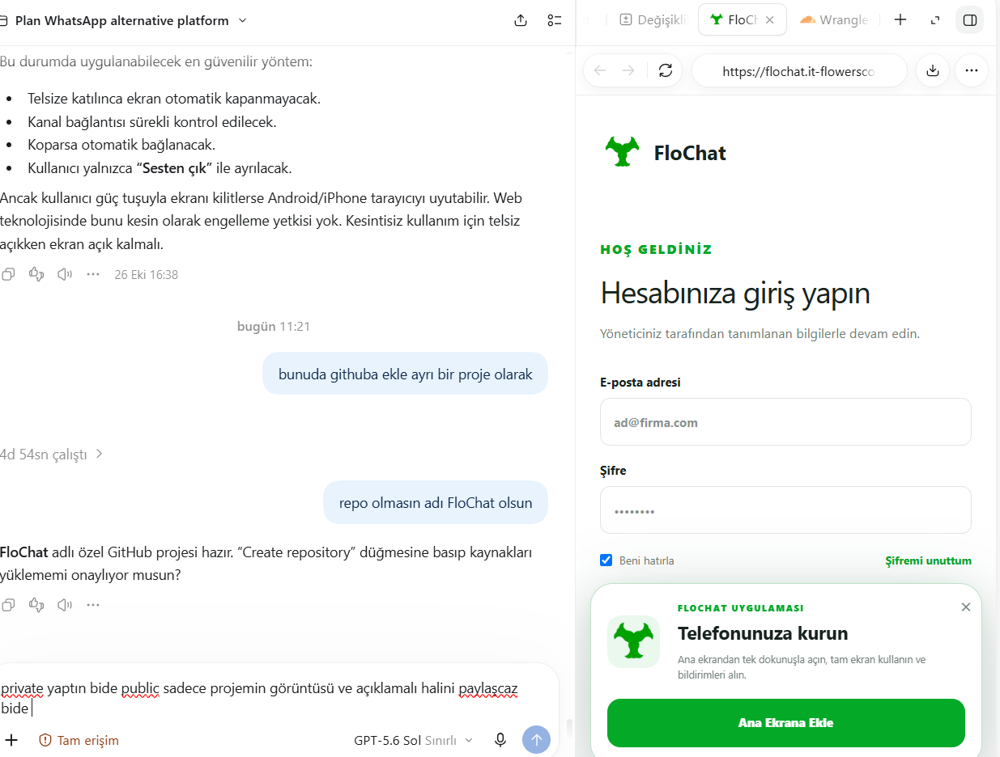

# FloChat

FloChat; ekiplerin mesajlaşma, grup yönetimi, görev takibi ve bas-konuş telsiz iletişimini tek yerde kullanabilmesi için geliştirilen web tabanlı bir kurumsal iletişim uygulamasıdır.

> Kaynak kodlar güvenlik nedeniyle özel depoda tutulmaktadır. Bu depo yalnızca proje tanıtımını içerir.

## Canlı uygulama

[FloChat'i aç](https://flochat.it-flowerscosmetic.workers.dev/)

## Öne çıkan özellikler

- Grup bazlı mesajlaşma ve medya paylaşımı
- Canlı bas-konuş telsiz kanalları
- Kanal sesi katılımı ve konuşan kişi göstergesi
- Yönetici kontrollü kullanıcı ve grup yetkileri
- Kişi bazlı görev atama ve onay akışı
- Silinen ve düzenlenen mesajlar için denetim kayıtları
- Web, masaüstü ve telefon uyumlu PWA deneyimi
- Bildirimler, profil ayarları ve kalıcı oturum
- Ağ dışı erişimi kullanıcı bazında sınırlandırma

## Önizleme

## Durum

FloChat aktif olarak geliştirilmektedir. Canlı sürüm Cloudflare altyapısında çalışmaktadır.

---

© 2026 Flowers Cosmetic — FloChat
